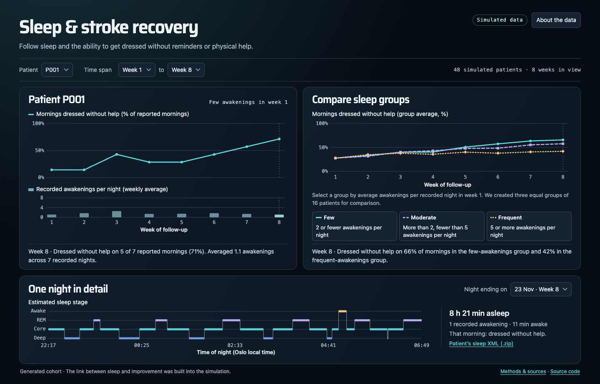

# Sleep & Stroke Recovery Explorer

**[Open the interactive dashboard](https://angelinasverchkova.github.io/sleep-recovery-explorer/)**

Explore how sleep interruptions and the ability to get dressed without help change over eight weeks after stroke. All 48 patients are fictional. The simulation intentionally gives the groups different average recovery patterns.

To try it, select **Frequent** in **Compare sleep groups**. The patient list narrows to the 16 people in that group. Choose one patient and a morning to compare their overnight sleep stages with the help they needed to get dressed.

[](https://angelinasverchkova.github.io/sleep-recovery-explorer/)

## Explore the dashboard

The live dashboard opens in a browser on desktop or mobile. For an offline copy, choose **Code → Download ZIP** on GitHub, unzip the whole project and open **index.html**.

1. Choose a patient and a first and last week. The left figure shows how often that patient dressed without help. The bars beneath it show how interrupted their sleep was over the same weeks.
2. Compare three lines in the right figure. Each represents patients grouped by average sleep interruptions during week 1. Select a group to highlight its line and browse its patients. Select it again to restore everyone.
3. Choose a week on either chart or a morning in the lower panel. Read the overnight stage trace from left to right and compare it with the person's report the next morning. The weekday selections and patient controls also work with the keyboard.
4. Open **About the data** for the study context and definitions. **Patient’s sleep XML** downloads the selected patient's generated export archive.

To explore a weekly line chart with the keyboard, tab to it and use the arrow keys to move between weeks. Home and End select the first and last weeks in the visible range.

## Study and demonstration

Yang and colleagues followed 306 stroke survivors and found an association between longitudinal sleep patterns and disability at 12 months. The authors used ActiGraph accelerometry and the modified Rankin Scale. This project uses Apple Health–style simulated intervals and an eight-week dressing diary. The data illustrate the analytical workflow and cannot estimate an effect in real patients. [Original study](https://pubmed.ncbi.nlm.nih.gov/41652308/) · [Methods and sources](docs/methods.md)

## Project map

| Location | Contents |
| --- | --- |
| `index.html` | Offline dashboard entry point, controls and study notes |
| `assets/model.js` | Weekly summaries and group comparison rules |
| `assets/charts.js` | Responsive SVG figures |
| `assets/app.js` | Patient selection, linked time window, group selection and night inspection |
| `assets/style.css` | Layout, typography and colour system |
| `pipeline/generate.py` | Seeded simulation, synthetic Apple exports and data build |
| `pipeline/health.py` | Stage parsing, session validation and overnight measures |
| `data/apple_health/` | 48 ZIPs, each containing `apple_health_export/export.xml` for one fictional patient |
| `data/*.csv` | Patient groups, sleep summaries and separate morning diaries |
| `data/dashboard.js` | Browser-ready copy of the parsed data for opening via `file://` |
| `docs/methods.md` | Evidence, assumptions, data dictionary and interpretation |
| `tests/` | Pipeline, generated-data, analytical and browser tests |

## Reproduce and test

Run commands from the project directory. Python 3.9+ with the IANA time zone database and Node.js 20+ are needed for development. The generator and analytical tests use their language's standard library.

```sh
python3 -m pipeline.generate
python3 -m unittest discover -s tests -p 'test_*.py' -v
node --test tests/model.test.cjs
```

To generate independently in another directory, pass `--output PATH`. The same seed, generator and Python runtime produce the same cohort. Generated files are staged before replacement. The browser reads one bundle, replaced last, so it always sees a complete dataset.

For optional end-to-end tests, install the pinned test driver and a Chromium browser. The dashboard itself has no package dependencies.

```sh
npm ci
npx playwright-core install chromium
npm run test:browser
```

Set `CHROME_BIN` to test with an already installed Chrome executable. On macOS one common location is `/Applications/Google Chrome.app/Contents/MacOS/Google Chrome`. Set `QA_DIR` to save desktop and phone screenshots during the browser test. The suite checks direct opening from disk, no network requests, filtering, range selection, missing data, the methods dialog and responsive layouts.
